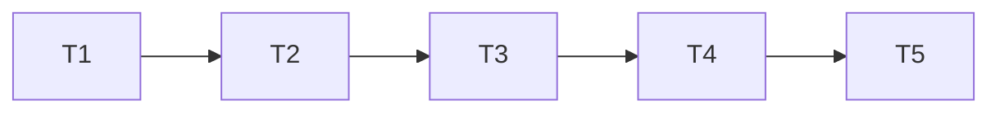

# Entrega de capas e sinopses

## Execution Plan

## Task Breakdown

### T1: cliente TMDB compartilhado e aliases
Where: clientes de metadados e adaptador do worker
Depends on: none
Tests: unitários atuais preservados, aliases/normalização/ambiguidade/fallback/erros e busca/detalhes
Gate: Full
- [x] Compartilhar cliente e modelos, reconhecer aliases oficiais equivalentes e expor Search/Details; sem associação por aproximação ou prefixo. Cliente público Netflix isolado para exceção autorizada pelo usuário, com identidade/host e conteúdo validados. CMS-01, AC1–2.

### T2: associação durável e enriquecimento independente
Where: armazenamento e worker
Depends on: T1
Tests: PostgreSQL de overrides, concorrência, identidade/dados preservados, CLI enrich e sync existentes
Gate: Full
- [ ] Migration aditiva, persistência compartilhada/lock e respeito a override no worker; comando de metadados sem Netflix. CMS-02, AC4–5/7.

### T3: API privada de busca e confirmação
Where: API e deploy
Depends on: T2
Tests: auth/Origin/JSON/consulta/tipo, falha remota e associação em lote sem alterar notas
Gate: Full
- [ ] Injetar cliente TMDB na API com token só no ambiente, buscar candidatos e confirmar detalhes oficiais por evento. CMS-03, AC3–4.

### T4: sinopses e identificação no app
Where: web e testes Chromium
Depends on: T3
Tests: browser com busca/erro/retry/seleção, capas/sinopses e notas preservadas, celular/teclado/PWA
Gate: Build
- [ ] Sinopse no card e MetadataDialog acessível; seletor de notas específico após acrescentar ação de metadados, preservando regressões. CMS-03, AC6.

### T5: catálogo real e implantação
Where: documentação e operação local
Depends on: T4
Tests: backup/restore isolado, migration/Compose/smoke, evidência de Naruto e pendências confirmadas; validadores
Gate: Build
- [ ] Documentar, fazer backup validado, implantar e reprocessar metadados; completar associações comprovadas e relatar limitações. CMS-04, AC8–9. Revisão independente após último commit, PR separado e CI verde.

## Test Coverage Matrix

T1: Full passou em banco sintético e Chromium, sem exclusão de casos anteriores. Evidência e mapeamento direto/reverso: AC1 → aliases_test.go:82/86/90/93 (alias único, ambiguidade, aproximação e truncamento); AC2 → aliases_test.go:123/127/159 (campos, idioma e falhas), netflix_test.go:54/73/112/128/173/196 (identidade, fallback GB, página genérica, CDN, erros e entrada/cancelamento sem HTTP). Todos pertencem a CMS-01; asserções conferem dados retornados além das chamadas. Os testes antigos foram movidos junto do cliente, mantendo seus resultados esperados.

| Camada | Cobertura |
| --- | --- |
| Cliente | Aliases oficiais, normalização, candidatos limitados, tipo/ID/detalhes, ambiguidade, fallback e erros sem token |
| Banco/worker | Mesma identidade da nota, lote entre pessoas, separação de obras/serviços, override futuro e corrida automática/manual |
| API | Autenticação, Origin, JSON, limites de entrada, estado sem token, erros sem gravação parcial |
| Browser | Sinopse visível, busca e seleção explícita, recuperação e foco, preservação de avaliações e cache privado |
| Operação | Backup validado, dados anteriores preservados, Naruto real, preenchimento confirmado e pendências honestas |

## Gate Check Commands

- Full: testes Go relevantes com integração em banco sintético 55432; execução serial.
- Build: npm --prefix web run build, .local/checks.py full quick vet build.
- Commits: validate_spec.py, validate_tasks.py, check_commit.py e git diff --check.
- Fechamento: revisão independente + sensor isolado, validate_state.py, CI verde no HEAD do PR.
