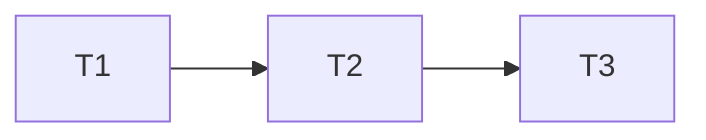

# Entrega do redesign Sessão

## Execution Plan

## Task Breakdown

### T1: tema, tipografia e navegação Sessão
Where: web
Depends on: none
Tests: existing Chromium regressions, visual inspection
Gate: Full
- [x] Alterar estilos, shell e marca para Sessão; alinhar login, conexões e diálogo ao tema; fontes locais licenciadas, metadados e shell PWA. Arquivos: web/src/style.css, app.css, App.tsx, icons.tsx, AuthScreen.tsx, Connections.tsx, RatingDialog.tsx (somente apresentação), web/index.html, web/public/manifest.webmanifest, web/public/fonts/*, web/vite.config.ts, api/internal/httpapi/pwa_browser_integration_test.go e session_pwa_integration_test.go. AC1/7/8. Build web e cinco fluxos Chromium passaram: Authentication, JournalAndIndividualRatings, PaginationAndRecovery, PWAOfflinePrivacy e SessionLocalFonts. Rebuild e Authentication repetidos após incluir link de salto de teclado. O novo teste exige fontes locais no cache e carregadas após reload offline, tema coerente e color-scheme escuro. A allowlist antiga recebe somente os dois novos WOFF2 públicos; a verificação de nenhum dado privado permanece. Journal/Poster aguardam T2; não foram alterados nesta tarefa.

### T2: histórico com destaque cinematográfico e fallback
Where: web/src
Depends on: T1
Tests: Chromium integration, existing history/ratings regression
Gate: Build
- [x] Renderizar o primeiro evento uma vez como destaque e outros por dia, com pessoa/serviço/notas reais, filtros originais, paginação e arte local quando faltar pôster. Arquivos: web/src/Journal.tsx, Poster.tsx, app.css, style.css (ocultação visual do link de salto) e api/internal/httpapi/session_browser_integration_test.go. AC2–7. TestBrowserSessionHighlightAndFilters falhou antes da implementação por não encontrar destaque, depois passou. Os três testes novos verificam evento exato, filtros/URL, zero/média, paginação, imagem falha/válida e teclado/320 px. Build web, Full/Quick/vet/build Go passaram após ajustes de títulos longos e dias com um registro. Capturas do build real foram inspecionadas com dados sintéticos, com e sem pôster, no desktop/celular e no diálogo. Nenhum teste antigo removido ou enfraquecido.

### T3: operação local e documentação do redesign
Where: docs
Depends on: T2
Tests: Compose build/up web, local smoke, spec validators
Gate: Build
- [x] Documentar o redesign e a ausência opcional de pôsteres em docs/app.md; atualizar só web no Compose e verificar preservação dos dados. AC9. Arquivos: docs/app.md e .specs/STATE.md. Compose build/up --no-deps web passou; prontidão, assets e ambas as fontes conferidos. Comparação antes/depois preservou contas/credenciais, sessões e 1248 eventos (zero notas no momento), além dos IDs de todos os demais containers. Nenhuma migration ou coleta executada. Revisão independente após este commit; PR baseado na Fase 2 e pronto apenas com CI verde.

## Test Coverage Matrix

| Camada | Cobertura |
| --- | --- |
| CSS e aparência | Inspeção de capturas desktop/celular, cores e foco; não testar valores cosméticos triviais como contrato |
| Browser | AC2–7 com dados sintéticos em PostgreSQL 55432; regressões existentes de login, notas, paginação, conexões e privacidade |
| PWA/build | Fontes locais no shell, manifest coerente e privacidade offline existente |
| Operação | Web saudável e mesmos IDs/contagens de dados pessoais antes/depois, sem expor credenciais |

## Gate Check Commands

- Quick: `go test ./...`.
- Full: `npm --prefix web run build` e `go test -tags=integration -count=1 ./api/internal/httpapi` com TEST_DATABASE_URL do banco sintético 55432.
- Build: build web, Full/Quick Go, go vet e go build; execução serial no Windows com GOMAXPROCS=2, GOFLAGS=-p=1 e GOMEMLIMIT=512MiB.
- Validadores: validate_spec.py, validate_tasks.py, check_commit.py antes de cada commit e validate_state.py após revisão independente.

## Evidência por tarefa

| Tarefa / critério | Asserção ou inspeção | Resultado |
| --- | --- | --- |
| T1 / AC1 | browser_integration_test.go:113 login/ativação/logout; journal_browser_integration_test.go:61 notas e conexões | Mesmos contratos e valores anteriores |
| T1 / AC8 | session_pwa_integration_test.go:37 tema/meta/scheme, :48 fonte exata no cache, :83 fontes carregadas após reload offline | Shell local e tema coerentes |
| T1 / privacidade | pwa_browser_integration_test.go:67 rejeita paths fora da allowlist; :87 exige zero notas após tentativa offline | Asserções preservadas, só dois assets públicos acrescentados |
| T2 / AC2–3 | session_browser_integration_test.go:20/:23 exige um destaque com ID esperado; :51 exige cada ID uma vez; :66 não aceita destaque em vazio; :77 exige URL; :106 exige 61 IDs distintos | Sem evento sintético, duplicado ou destaque obsoleto |
| T2 / AC5 | :56 aguarda média 5 após 0 e 10; :58 exige Sua nota: 0 e nota 10 da Gabriela; regressão antiga continua editando/removendo notas | Zero e separação das avaliações preservados |
| T2 / AC4/7 | :150 exige fallback sem img quebrada; :159 alvo ≥44; :169 foco após Escape; :183 imagem válida com espaço e prioridade | 1280/390/320 sem rolagem horizontal |

Os testes novos de T1 mapeiam exclusivamente AC8. As verificações cosméticas são inspeções, sem testes que espelham regras CSS.
