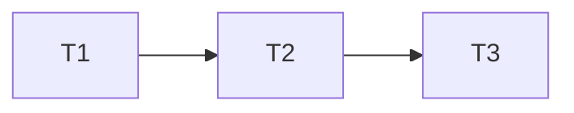

# Entrega do redesign Sessão

## Execution Plan

## Task Breakdown

### T1: tema, tipografia e navegação Sessão
Where: web
Depends on: none
Tests: existing Chromium regressions, visual inspection
Gate: Full
- [ ] Alterar estilos, shell e marca para Sessão; alinhar login, conexões e diálogo ao tema; fontes locais licenciadas, metadados e shell PWA. Arquivos: web/src/style.css, app.css, App.tsx, icons.tsx, AuthScreen.tsx, Connections.tsx, RatingDialog.tsx (somente apresentação), web/index.html, web/public/manifest.webmanifest, web/public/fonts/*, web/vite.config.ts. AC1/7/8. Preservar rótulos, ações e asserções existentes. Conferir build e todos os testes Chromium existentes antes de commitar.

### T2: histórico com destaque cinematográfico e fallback
Where: web/src
Depends on: T1
Tests: Chromium integration, existing history/ratings regression
Gate: Build
- [ ] Renderizar o primeiro evento uma vez como destaque e outros por dia, com pessoa/serviço/notas reais, filtros originais, paginação e arte local quando faltar pôster. Arquivos: web/src/Journal.tsx, Poster.tsx, app.css e api/internal/httpapi/session_browser_integration_test.go. AC2–7. Testes novos derivam dos critérios: destaque segue consulta, IDs únicos ao paginar, salvar zero, fallback de imagem, metadados e teclado/320 px. Executar suítes completas sem enfraquecer testes anteriores.

### T3: operação local e documentação do redesign
Where: docs
Depends on: T2
Tests: Compose build/up web, local smoke, spec validators
Gate: Build
- [ ] Documentar o redesign e a ausência opcional de pôsteres em docs/app.md; atualizar só web no Compose e verificar preservação dos dados. AC9. Arquivos: docs/app.md e .specs/STATE.md. Revisão independente após último commit; PR baseado na Fase 2 e pronto apenas com CI verde.

## Test Coverage Matrix

| Camada | Cobertura |
| --- | --- |
| CSS e aparência | Inspeção de capturas desktop/celular, cores e foco; não testar valores cosméticos triviais como contrato |
| Browser | AC2–7 com dados sintéticos em PostgreSQL 55432; regressões existentes de login, notas, paginação, conexões e privacidade |
| PWA/build | Fontes locais no shell, manifest coerente e privacidade offline existente |
| Operação | Web saudável e mesmos IDs/contagens de dados pessoais antes/depois, sem expor credenciais |

## Gate Check Commands

- Quick: `go test ./...`.
- Full: `npm --prefix web run build` e `go test -tags=integration -count=1 ./api/internal/httpapi` com TEST_DATABASE_URL do banco sintético 55432.
- Build: build web, Full/Quick Go, go vet e go build; execução serial no Windows com GOMAXPROCS=2, GOFLAGS=-p=1 e GOMEMLIMIT=512MiB.
- Validadores: validate_spec.py, validate_tasks.py, check_commit.py antes de cada commit e validate_state.py após revisão independente.
