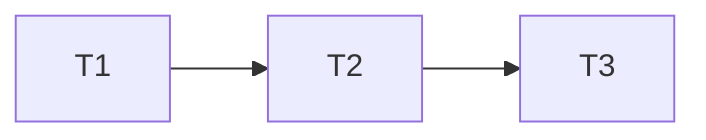

# Entrega de séries agrupadas

## Execution Plan

## Task Breakdown

### T1: agrupar séries na consulta
Where: api/internal/library e api/internal/httpapi
Depends on: none
Tests: integração PostgreSQL de agrupamento/filtros/paginação/notas e contratos brutos existentes
Gate: Full
- [ ] Adicionar group_series opcional, resumir por identidade antes do cursor e retornar participantes/quantidade; testes com mesmo nome e identidades distintas, mais de uma página e série sem TMDB. SAG-01, AC1–3/6.

### T2: apresentar série e avaliar obra inteira
Where: web e testes Chromium
Depends on: T1
Tests: Chromium de série única, filtros, nota zero/edição/remoção/pendentes, regressões existentes adaptadas ao novo contrato do app
Gate: Build
- [ ] Solicitar group_series, apresentar participantes/última assistida/quantidade e explicar nota da série; atualizar expectativas de contagem afetadas sem enfraquecer regressões. SAG-02, AC4–5.

### T3: documentar e atualizar app local
Where: docs/app.md, .specs/STATE.md e operação local
Depends on: T2
Tests: build Compose API/web e smoke/preservação de dados; validadores de spec/tasks
Gate: Build
- [ ] Documentar escolhas, atualizar somente API/web sem migrations, validar preservação e revisar independentemente antes do PR/CI. SAG-03, AC7.

## Test Coverage Matrix

| Camada | Resultado esperado |
| --- | --- |
| API/Postgres | Itens e totais exatos com filtros antes da agregação, paginação sem série repetida, filmes brutos preservados, nomes iguais separados |
| Notas | Mesma chave por série entre episódios/pessoas, zero/média/contador e remoção independentes |
| Browser | Uma série visível, pessoas reais, sem episódio, contrato de nota explícito e filtros/pendentes funcionais |
| Operação | Mesmos dados/identidades antes/depois; somente API/web recriadas |

## Gate Check Commands

- Full: testes Go de integração serial com banco sintético 55432, incluindo contratos brutos existentes.
- Build: npm --prefix web run build e .local/checks.py full quick vet build.
- Antes dos commits: validate_spec.py, validate_tasks.py, check_commit.py e git diff --check.
- Fechamento: Verifier independente após último commit, validate_state.py e CI verde no HEAD do PR.
